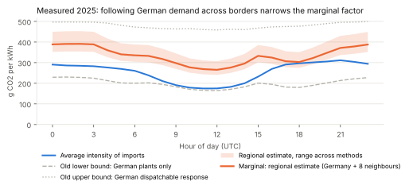
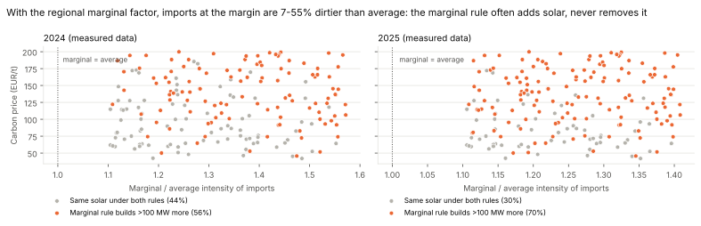
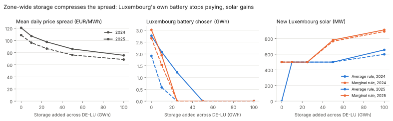
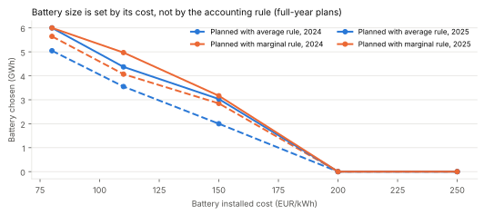
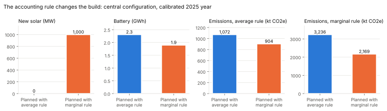
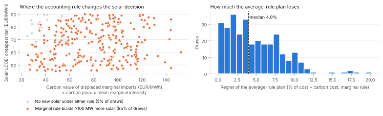
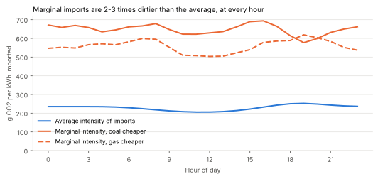

> HISTORICAL v0.5 REPORT: imported before the negative-price settlement correction. Numerical plans, uncertainty results and price-feedback claims below have not been reproduced with the merged code. See [merge validation](v0.5_merge_validation.md).

# Luxembourg case study: does the carbon-accounting rule change the solar plan?

## Version 0.5: regional marginal factor and price feedback

Version 0.5 removes the two largest limitations of version 0.4. Both fixes use
only measured data.

**1. The marginal factor is now estimated, not just bracketed.** Version 0.4
bracketed it between about 200 and 480 g/kWh. Version 0.5 adds hourly
generation for the eight neighbours that trade most with Germany (FR, BE, NL,
AT, CH, CZ, PL, DK), from the same Energy-Charts source. The regression now uses
the change in **regional** emissions (Germany plus neighbours) and controls for
each neighbour's own residual load, because weather moves together across
borders. It is run on daily totals, so that storage and reservoir hydro, which
shift energy between hours, are charged for the emissions of refilling them.

| Regional marginal factor | 2024 | 2025 |
|---|---|---|
| Central estimate (day-to-day differences) | **317 g/kWh** | **333 g/kWh** |
| Range: bootstrap 95% intervals, day-to-day and 7-day specifications | 276-394 | 302-386 |
| Of which: German plants | 237 | 237 |
| Of which: neighbours (mostly NL, CZ, PL) | about 80 | about 95 |
| Within-hour estimate, for comparison | 168 | 216 |
| Average intensity of imports | 257 | 255 |
| Old bracket (v0.4) | 200-468 | 199-479 |

The range narrows from about 270 g/kWh wide to about 85-120 g/kWh wide. It sits
entirely above the average intensity of imports: a marginal kWh is on average 23-31%
dirtier than an average one (7-55% across the range). The hourly shape is dirtiest at night, when coal
and gas set the margin, and closest to the average around midday.



**What this changes in the plans (full year, central estimate):**

| | 2024 | 2025 |
|---|---|---|
| New solar, average rule / marginal rule | 500 / 500 MW | 0 / 500 MW |
| Battery, average rule / marginal rule | 2.0 / 2.8 GWh | 3.0 / 3.2 GWh |
| Regret of the average-rule plan | 0.32% | 0.92% |
| Monte Carlo: marginal rule builds more solar / less | 56% / 0% | 70% / 0% |
| Monte Carlo median regret (95th percentile) | 0.9% (4.3%) | 0.8% (2.3%) |
| Out of sample: plan on one year, run on the other | 0.6% | 1.0% |

In the Monte Carlo, the carbon price and the marginal level matter most for the
solar gap (Spearman 0.50-0.52 and 0.28-0.37). The marginal rule builds the same
solar or more, never less, in every robustness check. Under the marginal rule
it also adds battery capacity, because the battery shifts imports out of the
dirtier night hours.



**2. Prices now respond to storage.** Version 0.4 took prices as given. Version
0.5 estimates the DE-LU supply curve from the same year's data: the median
day-ahead price as a non-decreasing function of German residual load, at about
EUR 1.7-1.9/MWh per GW around the median. A storage fleet across the bidding
zone is dispatched the way a competitive fleet would be in equilibrium: it
minimises the area under the supply curve, which flattens prices within each
day. Each hour is then moved along the curve, keeping its measured deviation
from the curve. Luxembourg's own battery is counted in the fleet, and its size
is iterated to a fixed point, so Luxembourg is no longer treated as a
price-taker.

| Storage added across DE-LU | 0 | 10 GWh | 25 GWh | 50 GWh | 100 GWh |
|---|---|---|---|---|---|
| Mean daily spread, 2025 (EUR/MWh; measured 124.8) | 120.8 | 107.3 | 97.6 | 86.0 | 75.5 |
| LU battery, average / marginal rule, 2025 (GWh) | 2.8 / 3.0 | 2.1 / 1.9 | 1.2 / 0 | 0 / 0 | 0 / 0 |
| LU new solar, average / marginal rule, 2025 (MW) | 0 / 500 | 500 / 500 | 500 / 500 | 500 / 782 | 656 / 912 |
| LU battery, average / marginal rule, 2024 (GWh) | 1.9 / 2.7 | 0.6 / 1.5 | 0 / 0 | 0 / 0 | 0 / 0 |
| Regret of the average-rule plan, 2025 | 1.1% | 0.0% | 0.4% | 0.3% | 0.4% |

Fleet sizes are additions to what is already reflected in 2024-25 prices.
German grid-scale batteries were about 3.5 GWh at the end of 2025, and
Fraunhofer ISE's modelling puts the need at 100-170 GWh by 2030.



Three results follow:

- Luxembourg's own optimal battery compresses the spread by only about 3%, so
  the price-taker assumption was close for Luxembourg alone.
- Storage built elsewhere in the zone is what matters. With 25 GWh more
  storage in DE-LU, Luxembourg's battery stops paying at EUR 150/kWh. The
  2-3 GWh in v0.4 is therefore a result for today's spreads, not a durable
  sizing.
- Zone storage makes solar more valuable, because it absorbs midday surpluses
  and cuts negative-price hours (477 to 203 in 2025 at 50 GWh). Both rules then
  build more solar. The marginal rule still builds more, by 0-290 MW, and the
  average rule's regret stays below about 0.5%.

### Remaining limitations (version 0.5)

- **Coverage of the response.** At daily scale, German plants, German pumped
  storage and the eight neighbours explain 57-61% of a change in German
  residual load. The rest is met outside that set: Nordic and Alpine
  reservoir hydro, Italy, and demand response. It is counted as zero-carbon,
  which biases the estimate down. Reservoir hydro's real cost is the thermal
  generation it displaces at other times, which this method does not see.
- **The supply curve is static.** It is estimated from one year with fuel and
  CO2 prices held at that year's levels. Shifts along it keep each hour's
  deviation from the curve, so spread compression may be understated in
  volatile hours.
- **Zone fleet assumptions.** The zone fleet has a 2-hour duration and is
  dispatched with perfect daily foresight. Luxembourg's battery has a 4-hour
  duration.
- Only two years of data, with direct rather than life-cycle factors. The
  industrial network (about 1.7 TWh) is not modelled.


## Version 0.4: bracketing estimates from German data only

**Answer.** On measured hourly data, counting imported electricity at its
marginal rather than its average carbon intensity **never leads to less new
solar and often leads to more**, but only when marginal imports are dirtier than
average. How much dirtier is the real uncertainty. Measured German data
bracket the marginal intensity between about 200 and 480 g/kWh, against an
average import intensity of about 256 g/kWh.

| Full-year plans (8,760 hours) | 2024 | 2025 |
|---|---|---|
| Marginal intensity, lower bound (German plants only) | 200 g/kWh | 199 g/kWh |
| Marginal intensity, upper data-based estimate (dispatchable response) | 468 g/kWh | 479 g/kWh |
| Average intensity of imports (flow-weighted DE/BE) | 257 g/kWh | 255 g/kWh |
| New solar, average rule / marginal rule, at the lower bound | 500 / 500 MW | 0 / 0 MW |
| New solar, average rule / marginal rule, at the upper estimate | 500 / 1,000 MW | 0 / 1,000 MW |
| Regret of the average-rule plan, at the upper estimate | 0.6% (EUR 2.6M/yr) | 2.8% (EUR 12.7M/yr) |
| Regret, stylised merit order (648 g/kWh) | 2.2% | 5.2% |

The Monte Carlo (200 draws a year) samples where the true marginal factor lies
between the two data-based estimates, along with solar cost, battery cost,
carbon price, price level and interconnector limits.

| Monte Carlo | 2024 | 2025 |
|---|---|---|
| Marginal rule builds >100 MW more solar | 57% of draws | 64% |
| ... when marginal is above average | 70% | 77% |
| Marginal rule builds less solar | 0% | 0% |
| Median regret (5th-95th percentile) | 0.4% (0-3.2%) | 1.0% (0-4.3%) |
| Spearman with the solar gap: position in the marginal range / carbon price | 0.59 / 0.42 | 0.54 / 0.48 |


**Why the two data-based estimates differ.** In 2025, only 28% of an hour-to-hour
change in German residual load was met by German fossil plants. The rest came
through cross-border trade and pumped storage. Regressing German emissions on
residual load (Hawkes 2010) therefore counts that 72% as zero-carbon, which makes
it a lower bound. Regressing emissions on the change in German *dispatchable*
output gives 505 g per MWh of thermal response (R² up to 0.83). That equals the
consequential factor only if the response met abroad is as carbon-intensive as
Germany's. The truth depends on which foreign plants respond, which this data
cannot identify. Both estimates are stable across the two years.

**Battery: resolved by planning on the full year.** With every hour in the
optimisation, the battery size no longer depends on which representative days
are picked. It depends on cost: both rules choose 1.6-3.0 GWh at EUR 150/kWh
and none at EUR 200/kWh. The accounting rule changes it by 18% or less, and
2025's wider price spreads raise it. Battery value under 15% price-forecast
errors is 91-92% of the perfect-foresight value. The battery result is
therefore a break-even cost of roughly EUR 150-200/kWh at 2024-25 DE-LU price
spreads, not a sizing recommendation, because a gigawatt-hour fleet would also
narrow the spreads it relies on.



**Out of sample.** At the upper marginal estimate, the plan made on 2025 data and
operated on 2024 shows 3.3% regret, and the 2024 plan on 2025 shows 0.2%. At the
lower bound, regret is within ±0.1% both ways.

**Robustness (full year, both estimates).** No battery, carbon prices of EUR 40
and 150/t, aggregated imports, freely chosen borders, and 36 representative
days instead of the full year all keep the direction: the marginal rule builds
the same or more solar, never less. The effect grows with the carbon price: at
EUR 150/t and the upper estimate, the gap is about 900 MW (2024) and 1,000 MW
(2025), with about 4% regret. Full tables are in `outputs/luxembourg_real_results.json`
after `ghg-luxembourg-real`.

### Measured data and scope

Source: public Energy-Charts API (Fraunhofer ISE), CC BY 4.0, retrieved
16 November 2026: Luxembourg, German, French and Belgian generation by type,
Luxembourg physical cross-border flows, DE-LU day-ahead prices, and German
cross-border trade and pumped storage. Fifteen-minute values are averaged to UTC
hours, and 29 February 2024 is dropped. Files:
`data/energycharts_lu_de_2024_hourly.csv` and `..._2025_hourly.csv`.

| 2025 check | Measured | Published |
|---|---|---|
| Physical imports from DE / BE (GWh) | 2,626 / 936 | 2,630 / 940 (Electricity Maps) |
| Mean day-ahead price (EUR/MWh) | 89.3 | 89.4 |
| Wind (GWh) | 466 | 467 (ILR) |
| Public-grid load (GWh) | 4,844 | 6,529 gross consumption (ILR) |
| Metered solar (GWh) | 429 | 627 (ILR) |

- **Load.** The public (Creos) grid load is 1.7 TWh below ILR's gross
  consumption. The gap is most likely the separate industrial network operated
  with the Belgian grid, which this study does not model.
- **Solar.** Unmetered self-consumption explains the solar gap. New solar uses
  the measured hourly shape at ILR's specific yield.
- **No physical line to France.** Luxembourg's public grid has no physical
  connection to France, so imports are split between Germany and Belgium using
  measured hourly flows.
- **Emission factors.** Intensities use direct combustion factors. They are
  below Electricity Maps' life-cycle values: DE 308 vs 336, BE 114 vs 179, FR 14
  vs 30 g/kWh.

### Remaining limitations

- The consequential marginal factor is bracketed, not pinned down. That would
  need a coupled multi-country model or flow-traced emissions.
- Prices are taken as given, so large battery fleets do not compress spreads.
- Only two years of data, with direct rather than life-cycle factors.
- The industrial network and its roughly 1.7 TWh of load are not modelled.

```bash
ghg-energycharts --year 2025        # where api.energy-charts.info is reachable
ghg-luxembourg-real --days 36 --draws 200
```

## Synthetic calibrated study (version 0.3)

The sections below describe the earlier run on a synthetic hourly year
calibrated to published 2025 totals, with a stylised merit-order marginal
factor of about 650 g/kWh. Measured data puts the marginal factor between 200
and 480 g/kWh, so the synthetic study's effect sizes (95% of draws, 4% median
regret) correspond to the top of that range.

#### Question

Luxembourg imports about three quarters of its electricity: 4,776 GWh of
6,529 GWh gross consumption in 2025 (ILR). When a planner values imported
electricity at the **average** carbon intensity of the exporting grids, does an
hourly cost-plus-carbon optimisation choose a different solar and storage
build than when imports are valued at their **marginal** intensity? And how
much does the difference cost when judged under marginal accounting?

### Answer (conditional on the assumptions below)

**The accounting rule changes the solar decision.** In the central
configuration, the average-rule plan adds no solar and the marginal-rule plan
adds 1,000 MW: the two cheaper cost tiers, but not the most expensive one.
Judged under marginal accounting, the average-rule plan costs EUR 29.2 million
a year more in cost plus carbon cost (4.4%).

| Central configuration | Planned with average rule | Planned with marginal rule |
|---|---|---|
| New solar | 0 MW | 1,000 MW |
| Battery (uncertain output; see robustness) | 2.3 GWh | 1.9 GWh |
| Emissions, average accounting | 1,072 kt | 904 kt |
| Emissions, marginal accounting | 3,236 kt | 2,169 kt |
| Imports / exports | 4,792 / 3 GWh | 3,929 / 182 GWh |

Across 300 Monte Carlo draws of eight uncertain inputs, the marginal rule builds
at least 100 MW more solar in **95%** of draws and less in none. In the other
5%, neither rule builds. The median extra solar is 1,000 MW (5th-95th
percentile: 475-1,500 MW). The median regret of the average-rule plan is 4.0%
(EUR 31 million a year), with a 5th-95th percentile range of 0.1-10.7%.





Spearman rank correlation with regret: carbon price 0.77, marginal-intensity
scale 0.32, gas-cheaper regime -0.25 (median regret 3.1% with gas cheaper than
coal, against 5.6% with coal cheaper), lignite must-run share 0.15. Battery
cost, interconnector limits and price level barely matter (|rho| < 0.06).

**Why:** marginal imports are 2.3 to 3.1 times as carbon-intensive as average
imports at every hour of the day. The average is pulled down by French nuclear
and German renewables, while the unit that responds to extra demand in the
DE-LU zone is usually lignite, hard coal or gas. Under average accounting
solar displaces imports worth about 230 g/kWh. Under marginal accounting it
displaces about 650 g/kWh, and exports earn the same credit.



#### A second finding: contract-based accounting rewards paper switching

If average accounting lets Luxembourg attribute imports to whichever
neighbour it chooses, within each interconnector's limit, the optimiser
"buys" French nuclear. Average-rule emissions fall 68%, from 1,072 kt to
341 kt, while marginal emissions barely move (3,236 kt to 3,151 kt). Physical
flows, and therefore real emissions, are set by the network, not by
contracts. This is the same mechanism critics raise about market-based
Scope 2 reporting.

### Data

`data/luxembourg_2025_inputs.json` holds every published figure with its
source and URL:

| Input | 2025 value | Source |
|---|---|---|
| Gross consumption | 6,529 GWh | ILR via [Chronicle.lu](https://chronicle.lu/category/surveys-reports/62120-solar-becomes-luxembourgs-largest-electricity-source-in-2025-ilr-reports) |
| Imports / domestic generation | 4,776 / 1,826 GWh | ILR via Chronicle.lu |
| Solar: capacity, generation | 746 MW, 627 GWh | ILR via Chronicle.lu |
| Wind generation | 467 GWh | ILR via Chronicle.lu |
| Imports by neighbour | DE 2.63, FR 1.17, BE 0.94 TWh | [Electricity Maps 2025 review](https://www.electricitymaps.com/grid-in-review-2025/luxembourg) |
| Average intensity of imports | DE 336, FR 30, BE 179 g/kWh | Electricity Maps |
| Day-ahead price (DE-LU) | mean EUR 89.4/MWh; hour-of-day mean 45-144 | Electricity Maps |
| Solar LCOE | US$59/MWh Europe, US$65/MWh Germany | IRENA 2025 via [PV Tech](https://www.pv-tech.org/solar-pv-lcoe-ticks-marginally-upwards-2025-irena/) |
| Battery installed cost | about US$140/kWh (4-hour, utility) | IRENA 2025 via [Balkan Green Energy News](https://balkangreenenergynews.com/irena-hybrid-renewable-systems-see-dramatic-cost-reductions/) |

#### Hourly profiles

ENTSO-E hourly data needs an API token, so the default run uses a
**synthetic 8,760-hour year**. Its annual totals match the published figures
exactly, and its hourly shapes are calibrated to published summary statistics:

| Statistic | Published | Model | Error |
|---|---|---|---|
| Annual consumption (GWh) | 6,529 | 6,529 | 0.0% |
| Solar / wind generation (GWh) | 627 / 467 | 627 / 467 | 0.0% |
| Peak load (GW) | 1.1 | 1.12 | +1.6% |
| Minimum load (GW) | 0.4 | 0.46 | +16.0% |
| Highest / lowest hour-of-day mean load (GW) | 0.8 / 0.6 | 0.86 / 0.66 | +7.6% / +9.3% |
| Weekday / weekend mean load (GW) | 0.7 / 0.6 | 0.78 / 0.67 | +10.9% / +11.2% |
| Mean day-ahead price (EUR/MWh) | 89.4 | 89.4 | 0.0% |
| Highest / lowest hour-of-day mean price | 144.0 / 45.4 | 143.2 / 41.1 | -0.6% / -9.6% |
| Negative-price hours | 545 | 428 | -21.5% |
| Import-weighted average intensity (g/kWh) | 229.3 | 229.3 | 0.0% |

The load statistics run 7-11% high because ILR's gross consumption (6.53 TWh,
which includes losses and self-consumption) is larger than the load
Electricity Maps reports (6.1 TWh). The model keeps the ILR total.

To replace the synthetic year with measured data, including marginal factors
estimated from German generation:

```bash
export ENTSOE_API_TOKEN=...   # free, from transparency.entsoe.eu
ghg-entsoe --year 2025 --estimate-marginal --output data/luxembourg_entsoe_hourly.csv
ghg-luxembourg --profiles-csv data/luxembourg_entsoe_hourly.csv
```

### Method

#### Dispatch and investment model (`hourly_dispatch.py`)

A linear programme solved with SciPy's HiGHS solver chooses new solar,
battery energy and hourly operation to minimise annualised investment, plus
net energy cost, plus battery wear, plus a carbon price times emissions.

| Feature | Central setting (all assumptions) |
|---|---|
| Solar cost supply curve | 3 tiers of 500 MW at 1.0x, 1.3x and 1.7x the LCOE (large roofs and ground-mount first, small roofs last) |
| Battery | 4-hour; annuity at 6% over 15 years plus 2% O&M; wear = capex / 6,000 cycles per MWh discharged; at most 1.5 cycles a day |
| Imports | split across DE, FR and BE in fixed 2025 shares; assumed interconnector limits DE 1,000, BE 650, FR 400 MW, so the tightest border caps the total |
| Exports | up to 300 MW, paid 90% of the price |
| Marginal factor | hourly series from the German merit-order model (below) |
| Foresight | battery cost scaled by 1 / retained value under forecast errors (below) |

| Rule | Import factor | Export credit |
|---|---|---|
| Average (attributional) | hourly import-weighted average intensity of DE, FR and BE | none |
| Marginal (consequential) | hourly marginal intensity of the DE-LU zone | same as import factor |

Each plan is re-dispatched with its capacities fixed and scored under the
marginal objective. **Regret** is the extra annual cost plus carbon cost of
the average-rule plan. The year is compressed to 24 representative days by
k-means on daily load, solar, wind and price shapes.

#### Marginal emission factors (`marginal_emissions.py`)

- **Merit-order model.** A synthetic German residual load (load minus wind and
  solar), correlated with Luxembourg's weather, is ranked into percentiles and
  mapped onto a stylised supply stack: renewable surplus, lignite, then hard coal
  and combined-cycle gas in an order set by the fuel-price regime, then gas
  peakers. Intensities are typical direct emissions: lignite 1,100, hard coal
  850, CCGT 370, OCGT 550 kg/MWh. The central series averages 648 g/kWh
  (10th-90th percentile 370-975).
- **Statistical estimator.** Following Hawkes (2010, *Energy Policy* 38,
  5977-5987), it regresses hour-to-hour changes in system emissions on changes
  in residual load within load bins. On a synthetic zone where the true
  marginal factor is known, the estimated hourly series correlates 0.85 with the
  truth, and its mean is within 3%. `ghg-entsoe --estimate-marginal` applies it
  to measured German generation.

#### Imperfect foresight (`foresight.py`)

The plan's battery is re-operated on forecast prices (actual price plus
autocorrelated error of 15% of the mean price) and settled at actual prices.
It keeps **90%** of the value the LP assumes, so planning scales battery cost
by 1/0.90.

#### Monte Carlo

Ranges, all uniform and all assumptions: fuel-price regime (coal or gas
cheaper, 50/50); lignite must-run share 0.2-0.8; marginal-intensity scale
x0.8-1.2; solar LCOE EUR 45-90/MWh; battery capex EUR 110-250/kWh; carbon price
EUR 40-200/t; price level x0.75-1.25; interconnector limits x0.7-1.3.

### Robustness checks

| Check | New solar, average vs marginal rule | Regret |
|---|---|---|
| Central configuration | 0 vs 1,000 MW | 4.4% |
| Full 8,760 hours instead of 24 representative days | 0 vs 1,000 MW | 3.1% |
| 36, 48 or 72 representative days (two clusterings each) | 0 vs 1,000 MW | 3.2-4.1% |
| Synthetic weather years, seeds 1-4 | 0 vs 1,000 MW | 1.9-3.9% |
| Gas cheaper than coal | 0 vs 1,000 MW | 2.3% |
| Flat marginal factor with midday dip (version 0.2 method) | 0 vs 500 MW | 1.1% |
| One aggregated import, no border limits | 0 vs 1,000 MW | 4.4% |
| Borders chosen freely | 0 vs 1,000 MW | 4.5% |
| No battery allowed | 0 vs 1,000 MW | 4.3% |
| Battery at perfect foresight (no derating) | 0 vs 1,000 MW | 4.4% |
| Single solar cost tier (linear costs) | 0 vs 1,500 MW | 8.7% |

The solar decision is the same in every check. **Battery size is not robust**:
it ranges from 1.0 to 2.5 GWh depending on the representative-day clustering.
It should be read as "storage is valuable under these price shapes", not as a
sizing recommendation.

### Limitations

What version 0.3 addresses compared with 0.2: costs are no longer linear (solar
tiers); battery value is no longer unlimited (wear, cycle cap, forecast
derating); imports respect per-border limits; and the marginal factor follows
residual load through a merit order, with an estimator for measured data.

Remaining limitations:

- **Synthetic hourly shapes and a synthetic German residual load** until
  ENTSO-E data is used. The merit-order stack is stylised: shares and
  intensities are assumptions, and there is no plant-level unit commitment.
- **Price-taker.** Germany's demand is about 80 times Luxembourg's, which
  justifies this for solar. A gigawatt-hour-scale battery fleet would still
  narrow the price spreads it relies on, which is not modelled.
- **No internal grid** and fixed physical import shares. Real flow shares vary
  hourly with flows in the wider meshed network.
- **One marginal factor for all borders.** French and Belgian marginal units
  can differ from Germany's.
- **No investment in flexibility** beyond batteries, such as demand response,
  heat pumps or electrolysers.

### Reproduce

```bash
pip install -e .
ghg-luxembourg --draws 300            # writes outputs/ and figures/, prints the robustness table
python -m unittest tests.test_luxembourg -v
```
