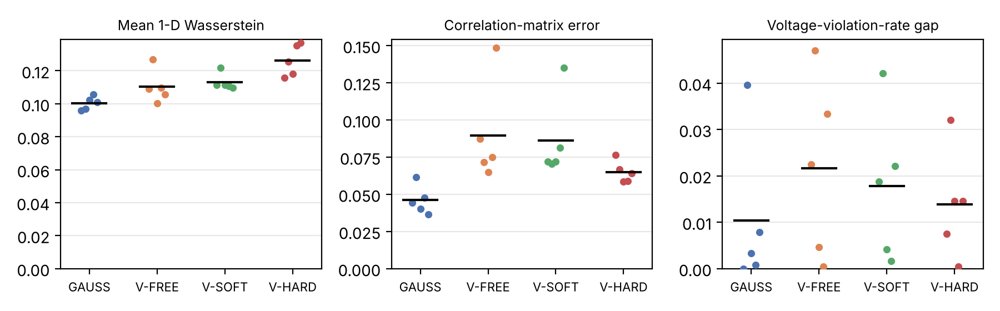
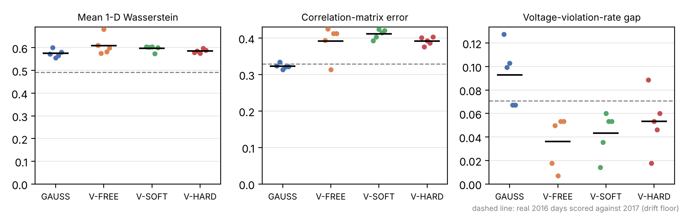
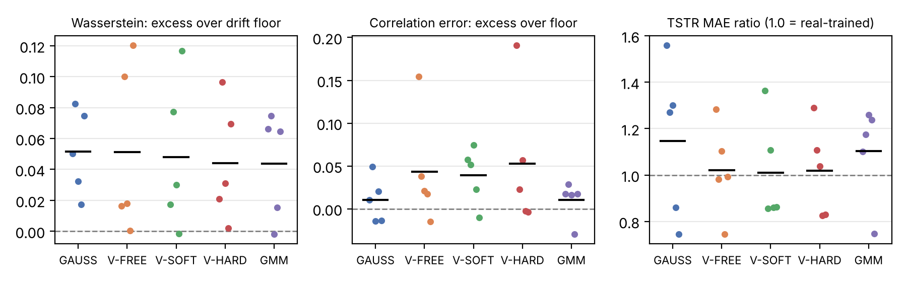

> HISTORICAL RECORD: predates the validation/accounting correction. Numerical results and inferential claims below are not current validated findings. See [correction notes](synthetic_grid_corrections.md).

# Synthetic feeder energy data and emissions accounting (simulated pilot)

## Why this is in a GHG repository

Emission estimates are only as good as the activity data behind them, and real
electricity-use data are often private or fragmentary. This module asks a narrow
question that links the two halves of the repository:

> Can a generative model produce synthetic load data that respect network physics
> and still give the same electricity activity and emissions estimates as the data
> it was trained on?

`ghg_model.synthetic_grid` generates synthetic daily load profiles for a simulated
radial feeder, checks them against power-flow physics, and converts any set of
days, real or synthetic, into the repository's `Activity` record so the existing
scenario, sensitivity and Monte Carlo tools can use it.

**Scope.** Three studies, each with a protocol locked before any model was trained.
Study 1 ([protocol](synthetic_grid_protocol.md)) uses fully simulated data. Study 2
([protocol](synthetic_grid_real_protocol.md)) replaces the simulated loads with real
building electricity data to test whether Study 1's conclusions survive. Study 3
([protocol](synthetic_grid_rolling_protocol.md)) repeats the real-data comparison over
five rolling origins, so the data change between replicates, and adds a Gaussian-mixture
baseline. In all three, the feeder and its voltages are simulated, so none describes a
real network.

## Design

- **Network:** 9-bus radial feeder (slack plus 8 load buses, three with PV) with an
  exact AC load flow (forward-backward sweep, NumPy).
- **Sample:** one day, 8 buses x 24 hours of net injection. Weather drivers,
  weekday effects and autocorrelated noise are shared across buses.
- **Arms:** a PCA-Gaussian baseline; a VAE on injections and voltages jointly
  (`VAE-FREE`); the same VAE with a soft penalty toward a linear power-flow
  surrogate (`VAE-SOFT`); and a VAE on injections only with voltages from the exact
  solver (`VAE-HARD`). The VAEs are written in NumPy with hand-derived gradients
  (checked against finite differences in the tests).
- **Seeds and splits:** five seeds; 800 train, 100 validation, 600 real-test days.
- **Metrics:** power-flow residual, voltage-violation-rate gap, per-feature
  Wasserstein distance, correlation-matrix error, train-synthetic-test-real (TSTR)
  forecasting error, a memorisation proxy, and two exploratory emissions metrics.

## Study 1: simulated data. Results (means over five seeds)

| Metric (lower is better) | GAUSS | VAE-FREE | VAE-SOFT | VAE-HARD |
|---|---|---|---|---|
| Power-flow residual (pu) | 0 (by construction) | 0.0011 | 0.0011 | 0 (by construction) |
| Voltage-violation-rate gap | 0.010 | 0.022 | 0.018 | 0.014 |
| Wasserstein distance (standardised) | 0.100 | 0.110 | 0.113 | 0.126 |
| Correlation-matrix error | 0.046 | 0.090 | 0.086 | 0.065 |
| TSTR MAE ratio (1.0 = same as real-trained) | 1.00 | 1.03 | 1.02 | 1.01 |
| Memorisation share | 0.009 | 0.002 | 0.002 | 0.002 |
| *Exploratory:* error in mean daily emissions, flat factor | 0.8% | 0.7% | 0.7% | 0.5% |
| *Exploratory:* error in mean daily emissions, assumed time-of-day factor | 0.8% | 0.7% | 0.7% | 0.5% |



Full per-seed values and paired intervals are in
`output/synthetic_grid/raw.csv` and `output/synthetic_grid/summary.txt`.

### What the predeclared questions show

- **Physical consistency (Q1).** The hard physics layer gives exactly zero
  power-flow residual, by design. The soft penalty did not help: its residual was
  lower than the unconstrained VAE's in only 3 of 5 seeds, so the predeclared
  criterion (at least 4 of 5) is not met. The unconstrained VAE's residual is
  already about 0.001 pu, so the practical stakes are small in this setup.
- **Fidelity cost (Q2).** No detectable cost of the hard layer against the
  unconstrained VAE (Wasserstein +0.016, 95% interval -0.0005 to +0.033;
  correlation error -0.025, interval -0.067 to +0.018; paired t-intervals, n = 5).
- **Utility and privacy (Q3, descriptive).** TSTR error is within 3% of training on
  real data for every arm, and the memorisation proxy is far below the 5% reference.
- **Unplanned finding.** The Gaussian baseline is better than the hard-layer VAE on
  Wasserstein distance (+0.026 for the VAE, interval +0.016 to +0.036) and
  correlation error (+0.019, interval +0.005 to +0.033). On this small simulated
  problem the VAEs do not beat a linear model.

### Emissions link (exploratory)

Daily emissions are feeder import (PV export is not credited) times a factor. The
flat factor is the repository's illustrative 0.18 kg CO2e/kWh. The "time-of-day"
variant multiplies it by an **assumed** hourly shape (dirtier evening peak, mean 1)
that is not data. Synthetic days reproduce mean daily emissions within about 1% on
average for every arm, and the arms cannot be separated with five seeds (standard
deviations of 0.3 to 0.5 percentage points). The assumed shape changes nothing
measurable here, so this result says nothing about real hourly emission factors.
`electricity_activity()` turns real or synthetic days into an `Activity` whose
uncertainty is the relative standard error of the mean daily import, ready for the
existing scenario and Monte Carlo tools.

## Study 2: real building loads on the simulated feeder

**Why.** A reviewer can fairly say that in Study 1 the generator and the models may
share structure. Study 2 takes the loads from real data and keeps only the network
physics simulated.

**Data.** Eight real hospitality buildings (six food service, two hotels) from the open
Building Data Genome Project 2 (BDG2 v1.0), daily electricity in kWh over 2016 and
2017, taken unchanged from the author's `hospitality-sustainability-ai` importer
([`data/real/`](../data/real/bdg2_hospitality_daily_provenance.json)). A sample is
one day on which all eight buildings report (645 days). The split is chronological:
282 train and 50 validation days from 2016, and the 313 days of 2017 as real-test.
The buildings are mapped to buses 1 to 8 in alphabetical order. One scale factor
(similar premises per bus, 4.34), calibrated on train days only, makes 10% of train
days violate 0.95 pu.

**What is and is not real.** The loads, their joint variation and the 2016-to-2017
shift are real. The feeder is not: the buildings sit at different sites, the network
and voltages are simulated, and only daily totals exist, so each sample is a daily-mean
operating point rather than an hourly profile. The data are fixed across the five
seeds, so the seed intervals reflect training and sampling randomness only, not
variation in which days were drawn.

**Read every metric against the drift floor.** The 2017 test year differs from 2016
(some buildings used much less electricity, and 3.2% of 2017 days violate the voltage
limit against 10.3% of 2016 days). The dashed line in the figure scores the real 2016
days against 2017 with the same metrics, which is the best any model trained on 2016
could hope to do on distribution-matching metrics.

| Metric (lower is better) | GAUSS | VAE-FREE | VAE-SOFT | VAE-HARD | Drift floor |
|---|---|---|---|---|---|
| Power-flow residual (pu) | 0 (by construction) | 0.0025 | 0.0023 | 0 (by construction) | n/a |
| Wasserstein distance (standardised) | 0.575 | 0.610 | 0.597 | 0.585 | 0.492 |
| Correlation-matrix error | 0.323 | 0.391 | 0.411 | 0.392 | 0.330 |
| Voltage-violation-rate gap | 0.093 | 0.036 | 0.043 | 0.053 | 0.071 |
| TSTR MAE ratio (1.0 = same as real-trained) | 1.23 | 1.49 | 1.55 | 1.31 | n/a |
| *Exploratory:* error in mean total daily energy | 6.5% | 4.9% | 4.8% | 5.8% | 6.1% |
| Memorisation share | 0 | 0 | 0 | 0 | n/a |



### Predeclared outcomes

- **R1 (physics result).** The hard layer's residual is exactly zero. The soft penalty's
  residual was lower than the unconstrained VAE's in 4 of 5 seeds, so the predeclared
  criterion is met, but the difference is negligible (-0.0001, 95% interval -0.0003
  to +0.0001). In Study 1 the same criterion was not met (3 of 5).
- **R2 (baseline result).** The Gaussian baseline had lower Wasserstein distance than
  the hard-layer VAE in 4 of 5 seeds, so the criterion is met in direction, but the
  paired interval includes zero (VAE minus Gaussian +0.010, interval -0.012 to +0.031).
- **R3 (fidelity cost of physics).** Not supported: the hard layer's Wasserstein
  difference against the unconstrained VAE was -0.025 (interval -0.086 to +0.037) and
  the soft penalty's was -0.012 (interval -0.061 to +0.036).

### What else the real data show (exploratory, not predeclared)

- Most of the distance to the 2017 test set is temporal drift: Wasserstein distances
  of 0.575 to 0.610 compare with a floor of 0.492, and mean-energy errors of about 5 to
  6.5% compare with a floor of 6.1%. The models cannot be separated on those metrics.
- The Gaussian model reproduced the correlation structure better than every VAE
  (VAE-HARD minus Gaussian +0.069, interval +0.048 to +0.090) and gave better
  train-synthetic-test-real error than the unconstrained VAE (VAE minus Gaussian
  +0.26, interval +0.16 to +0.36).
- The hard layer gave better TSTR error than the unconstrained VAE (-0.18, interval
  -0.35 to -0.005); with many comparisons and five seeds, treat this as a lead and not
  a finding.
- The violation-rate gap favours the VAEs over the Gaussian, but all arms sit around
  the drift floor of 0.071, so this metric mostly reflects drift and chance.
- TSTR is weaker than in Study 1 for every arm, partly because the eight buildings
  are at different sites and carry little information about one another.

### What Study 2 changes

The physics result replicates on real loads (the hard layer costs no detectable
fidelity), and the Gaussian baseline again is not beaten by any VAE (Study 3 below
shows that ranking does not hold up across windows). The soft penalty
still does essentially nothing. The honest limits are the daily resolution, eight
buildings that do not share a feeder, a single two-year temporal split, a calibrated
scale factor, and data that are fixed across seeds.

## Study 3: rolling-origin evaluation on real loads

**Why.** Study 2 used one split and fixed data across seeds, so one lucky or unlucky split
could drive its conclusions. Study 3 slides the window five times (240 train, 40
validation and 120 test complete days, moving by 60 days), recalibrating the scale on
each train window, so the data differ between replicates. A Gaussian mixture (1 to 4
components by BIC, voltages from the exact solver) joins the arms as a stronger
classical baseline. Windows overlap, so the five replicates are not independent and the
paired intervals are optimistic.

**A data problem found by the first run.** In the last test window two of the eight
meters (`Lamb_food_Sylvia`, `Lamb_lodging_Harley`) report a constant 0.01 kWh per day,
probably a meter outage or closed building. My locked metric standardised by the test
window's standard deviation, which is then zero, and the Wasserstein distance exploded
to about 6.7e5. That was a flaw in my metric definition. I kept the discarded first run
in `output/synthetic_grid_rolling/discarded_first_run/`, changed the Study 3 metric to
standardise by the train window and to compute correlation error only over meters that
vary, and logged the change in the protocol's Deviations section. The flat meters stay in
the data. Studies 1 and 2 keep their locked definitions because their windows have no
flat meter.

Means over the five origins ("excess" is the value minus that origin's drift floor):

| Metric (lower is better) | GAUSS | VAE-FREE | VAE-SOFT | VAE-HARD | GMM |
|---|---|---|---|---|---|
| Power-flow residual (pu) | 0 (by construction) | 0.0022 | 0.0022 | 0 (by construction) | 0 (by construction) |
| Wasserstein, excess over floor | 0.051 | 0.051 | 0.048 | 0.044 | 0.044 |
| Correlation error, excess over floor | 0.010 | 0.043 | 0.039 | 0.053 | 0.010 |
| Voltage-violation-rate gap | 0.050 | 0.033 | 0.039 | 0.029 | 0.043 |
| TSTR MAE ratio (1.0 = real-trained) | 1.15 | 1.02 | 1.01 | 1.02 | 1.10 |

The mean drift floors are 0.635 (Wasserstein), 0.372 (correlation error) and 0.043
(violation gap).



### Predeclared outcomes

- **S3-1 (physics costs nothing).** Met. The hard layer's residual is exactly zero at
  every origin, and its Wasserstein difference against the unconstrained VAE is -0.007
  (paired 95% interval -0.038 to +0.024), so no fidelity cost is detectable.
- **S3-2 (Gaussian beats the hard-layer VAE).** Not met. The hard-layer VAE had the
  lower Wasserstein distance at 4 of the 5 origins, the opposite direction to Study 2,
  but the difference is small and its interval includes zero (-0.007, interval -0.027 to
  +0.013).
- **S3-3 (mixture beats Gaussian).** Met on the count (4 of 5 origins), but the
  difference is tiny and its interval includes zero (-0.008, interval -0.030 to +0.015).

### What else Study 3 shows (exploratory)

- **The physics result is the only reliable one.** The hard layer removes the 0.0022 pu
  residual in every origin (difference -0.0022, interval -0.0030 to -0.0014). Every
  other contrast between generators has an interval that includes zero.
- **The generator ranking is not stable.** In Study 1 and Study 2 the Gaussian baseline
  looked best on several metrics. Across rolling origins the VAEs are as good on
  Wasserstein distance and give better TSTR error (about 1.02 against 1.15), while the
  Gaussian and the mixture reproduce correlation structure better (excess 0.010 against
  0.039 to 0.053). None of these differences is statistically reliable here.
- **Drift dominates.** Raw Wasserstein distances (about 0.68) sit close to the drift
  floors, and the window containing the two flat meters has a floor of 1.06.

## Limitations of Study 1

Simulated data from the author's own generator, so generator and models may share
structure that real data lack (Study 2 above addresses this for the loads); one 9-bus topology; hourly resolution; small NumPy
VAEs rather than diffusion, flow matching or graph networks; a linear surrogate in
the soft penalty; five seeds; a memorisation proxy that is not differential
privacy; an assumed time-of-day factor shape. The voltage relation here is
learnable from data, which may understate the benefit of hard constraints on
larger or more nonlinear networks.

## Reproduce

```bash
pip install -e ".[synthetic]"
python -m unittest discover -s tests -v
ghg-synthetic-grid                 # 4 arms x 5 seeds, about 4 minutes on 2 CPU cores
python scripts/plot_synthetic_grid.py   # regenerate the Study 1 figure from output/synthetic_grid/raw.csv
ghg-synthetic-grid --study real       # Study 2: real BDG2 building loads, about 15 seconds
ghg-synthetic-grid --study rolling    # Study 3: five rolling origins plus a GMM arm, about 15 seconds
python scripts/plot_synthetic_grid.py real      # or: rolling
ghg-synthetic-grid --seeds 0 --epochs 20 --output outputs/quick   # fast smoke run (no intervals with one seed)
```

## What remains limited, stated plainly

These cannot be removed from inside this workspace and are not hidden by the studies above.

- **No real feeder.** The network, impedances and voltages are simulated in all three
  studies. Real feeder measurements, or a published benchmark network with real loads,
  would be needed to test voltage claims.
- **No hourly real data.** Only daily totals were reachable (the BDG2 hourly file is
  served through Git LFS, which the session's proxy does not provide). Study 2 and 3
  are daily-mean operating points.
- **Small real sample.** Eight buildings at different sites, 645 usable days, eight
  features, two of which flatline for part of the data.
- **Weak generators.** The VAEs are small NumPy models. Diffusion, flow matching and
  graph networks need a deep-learning framework that could not be installed here.
- **Privacy.** The memorisation share is a crude proxy, not differential privacy.
- **Overlapping windows.** Study 3's replicates are not independent, so its intervals
  are optimistic.
